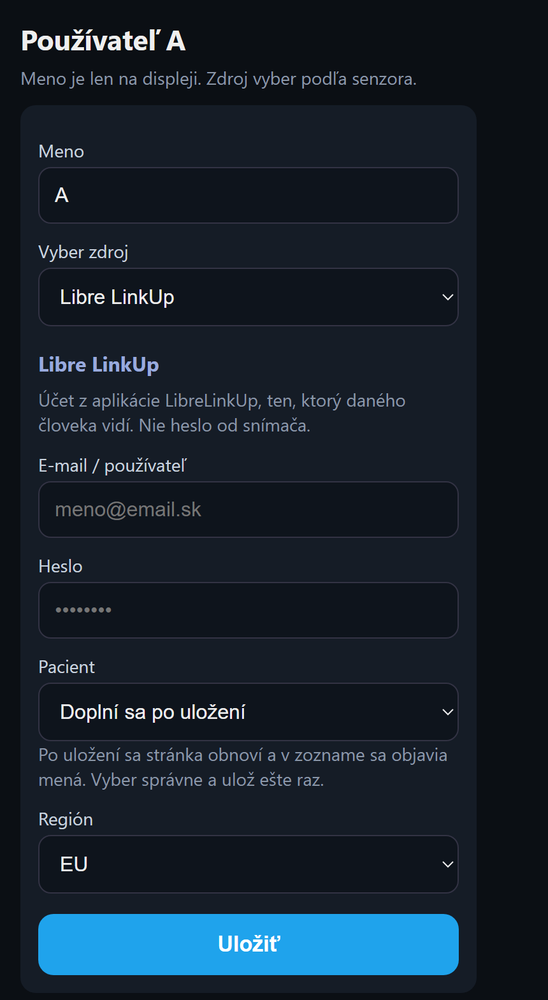
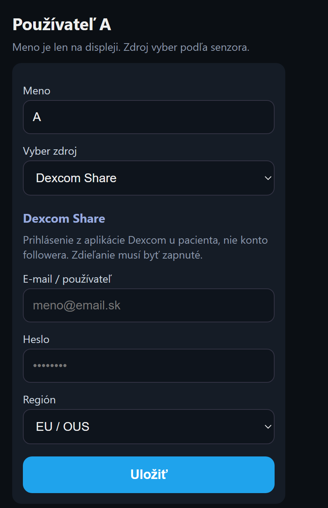
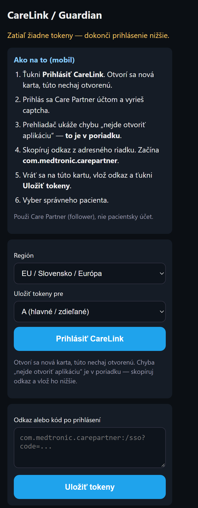

# GlukoView — LibreLink, Dexcom a Guardian

GlukoView je len informatívny displej. Nie je zdravotnícka pomôcka. Dávku inzulínu a rozhodnutie o liečbe rob vždy v aplikácii od výrobcu senzora.

Nastavenie je v prehliadači telefónu, nie na displeji.

## Ako otvoriť nastavenie

1. Telefón aj displej musia byť na tej istej WiFi.
2. Na displeji otvor **Informácie**. Je tam IP adresa, napríklad `192.168.1.50`.
3. Tú adresu napíš do Chrome alebo Safari.
4. Ťukni **Parametre a zdroje**. Pri prvom spustení ťa prevedie **Sprievodca nastavením**.

Kým displej ešte nemá domácu WiFi: na telefóne sa pripoj na sieť `GlukoView`, v prehliadači otvor `10.1.1.1`, vyber svoju WiFi a zadaj heslo. Potom pokračuj sprievodcom.

Kruhový displej ukazuje jedného človeka. Široký vie ukázať dvoch vedľa seba. Pri dvoch ľuďoch sa každý nastaví zvlášť, A a potom B.

## LibreLink

Použi účet z aplikácie **LibreLinkUp**, ten, ktorý daného človeka vidí. Nie je to heslo od snímača.

Na Slovensku nechaj región **EU**.

1. Pri zdroji vyber **Libre LinkUp**.
2. Napíš e-mail a heslo.
3. Ťukni **Uložiť**.
4. Stránka sa obnoví a v poli **Pacient** sa objavia mená. Vyber správne a ulož ešte raz.

Jedno Libre konto a dvaja ľudia: rovnaký e-mail a heslo pri A aj pri B, iné meno v poli Pacient. Dve kontá: pri B iný e-mail a heslo.

Keď prihlásenie zlyhá, skontroluj e-mail, heslo a región. Keď zoznam mien ostane prázdny, je to účet, ktorý v LibreLinkUp nikoho nevidí.

## Dexcom

Použi prihlásenie z aplikácie **Dexcom u pacienta**. Konto z aplikácie Follow nestačí. V aplikácii Dexcom musí byť zapnuté zdieľanie (Share).

Na Slovensku nechaj región **EU / OUS**.

1. Pri zdroji vyber **Dexcom Share**.
2. Napíš e-mail a heslo.
3. Ťukni **Uložiť**.

Meno pacienta sa tu nevyberá. Displej číta hodnotu z tohto jedného účtu.

## Guardian (CareLink)

Použi účet **Care Partner** (nasledovateľ). Nie je to účet pacienta, ktorým sa ovláda pumpa.

Na Slovensku nechaj región **EU / Slovensko / Európa**. Pri jednom CareLink konte nechaj **A (hlavné / zdieľané)**.

1. Pri zdroji vyber **Guardian (CareLink)** a ťukni **Prihlásiť CareLink**.
2. Na stránke CareLink ťukni **Prihlásiť CareLink**. Otvorí sa nová karta. Tú pôvodnú nechaj otvorenú.
3. Prihlás sa a vyrieš captcha.
4. Prehliadač napíše, že nevie otvoriť aplikáciu. **To je v poriadku.** Nič neinštaluj.
5. Skopíruj celý odkaz z adresného riadku. Začína `com.medtronic.carepartner`.
6. Vráť sa na pôvodnú kartu, odkaz vlož do poľa a ťukni **Uložiť tokeny**.
7. Na tej istej stránke vyber správneho pacienta a ulož ho.

Odkaz platí asi 10 minút. Keď vyprší, začni znova od kroku 2.

Jedno CareLink konto a dvaja ľudia: prihlás sa raz a pri A a pri B vyber iného pacienta. Dve CareLink kontá: pri B zopakuj prihlásenie a v poli „Uložiť tokeny pre“ vyber **B**.

